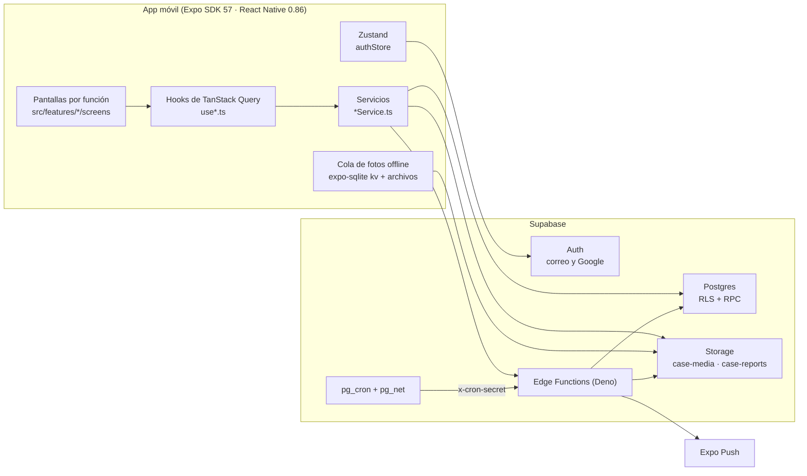
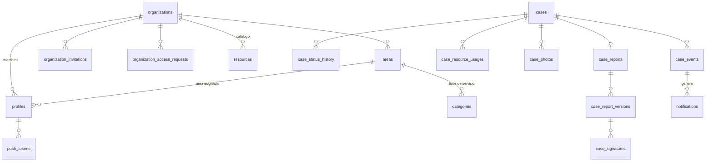
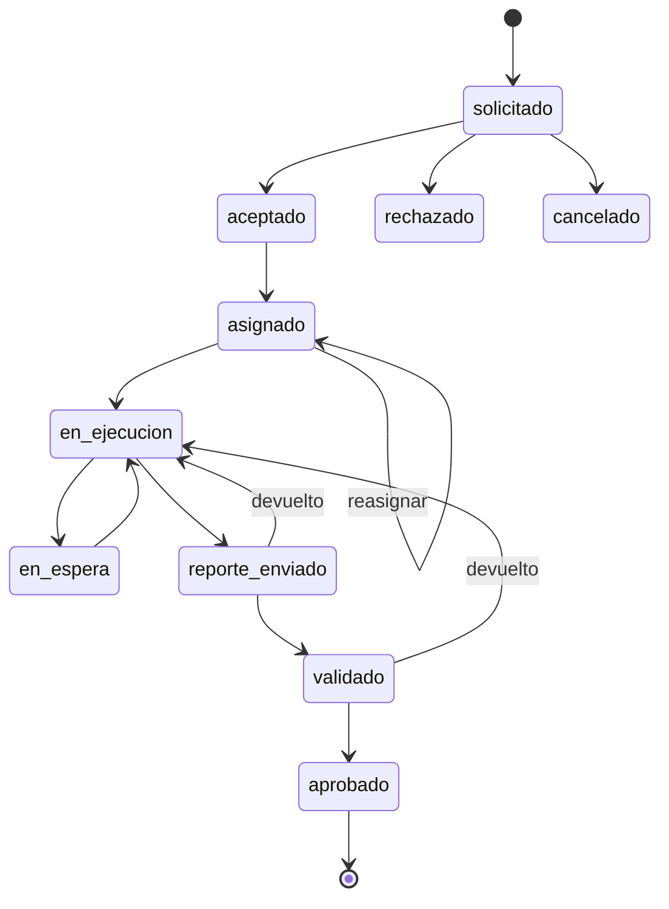
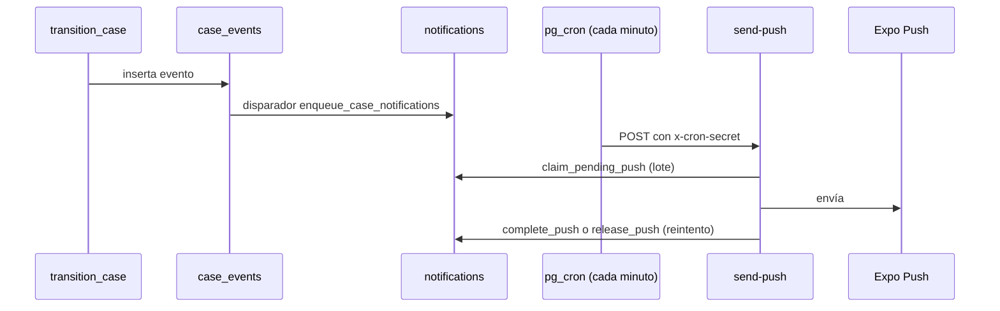

# Arquitectura de Nexo Casos

Borrador del 14/10/2026, escrito sobre `origin/develop` (`b8be333`). Describe cómo está
construido el sistema hoy. Las reglas que el sistema debe cumplir están en
`docs/BUSINESS_RULES.md`; el estado de cada tarea, en `docs/AGENT_HANDOFF.md`. Si este
documento contradice al código, manda el código.

## 1. Vista general

Nexo Casos es una app móvil B2B multiempresa (Android e iOS) donde las áreas de una
empresa piden mantenimiento al área técnica, que lo atiende, registra los recursos usados
y entrega un reporte firmado y aprobado.



Principio central: **el servidor decide**. Toda regla de negocio (quién ve qué, quién
puede mover un caso, quién firma) vive en Postgres, con RLS y funciones RPC. El cliente
repite esas reglas solo para mostrar u ocultar botones; si el cliente se equivoca, el
servidor rechaza la operación.

## 2. Stack

| Capa               | Tecnología                                                                     |
| ------------------ | ------------------------------------------------------------------------------ |
| App                | Expo SDK 57, React Native 0.86, React 19, TypeScript estricto                  |
| Navegación         | React Navigation 7 (pestañas inferiores + pilas nativas)                       |
| Datos del servidor | TanStack Query 5                                                               |
| Estado local       | Zustand (sesión y perfil)                                                      |
| Formularios        | React Hook Form + Zod                                                          |
| Backend            | Supabase: Auth, Postgres 16, Storage, Edge Functions (Deno)                    |
| Tareas programadas | `pg_cron` + `pg_net`, configuradas por entorno (no en migraciones)             |
| Avisos push        | `expo-notifications` en la app (pendiente, T-908), Expo Push en el servidor    |
| Builds             | EAS (`preview` → APK interno, `production` → AAB)                              |
| CI                 | GitHub Actions: calidad del cliente, migraciones + pruebas SQL, Edge Functions |

## 3. Estructura del repositorio

```text
App.tsx                 Arranque: fuentes, intro, sesión, cola de fotos, navegación
src/
  components/           UI compartida (acciones, badges, formularios, timeline, ui)
  config/               env.ts (variables públicas validadas), queryClient, queryLifecycle
  features/<función>/   Un módulo por dominio (ver 3.1)
  navigation/           AuthNavigator, MainNavigator y tipos de rutas
  services/
    supabase/           client.ts (tipado con Database), database.types.ts (generado),
                        database.ts (ajustes a los tipos) y secureStorage.ts
    feedback.ts         Mensajes y errores para el usuario
  store/                authStore.ts (Zustand)
  theme/                Tokens visuales, formateadores, metadatos de estado
supabase/
  migrations/           Esquema, RLS y RPC (31 migraciones, fuente de verdad)
  functions/            generate-report-pdf, send-push, cleanup-photos y _shared/
  tests/                Pruebas SQL por tarea (stub de Supabase + semillas)
scripts/                test-supabase-migrations.sh (usado por el CI)
docs/                   Reglas, plan, tablero de agentes, sistema visual
```

### 3.1 Módulos por función

Cada carpeta de `src/features/` sigue el mismo patrón:

- `types.ts`: tipos del dominio en camelCase.
- `*Service.ts`: única capa que habla con Supabase (`from`, `rpc`, `storage`,
  `functions.invoke`). Traduce filas snake_case a tipos del dominio.
- `use*.ts`: hooks de TanStack Query (consultas, mutaciones, claves de caché e
  invalidaciones).
- `*Permissions.ts`: espejo de las reglas del servidor para la interfaz.
- `schemas.ts`: validación Zod de formularios.
- `screens/` y `components/`: interfaz.

| Módulo                       | Qué cubre                                                          |
| ---------------------------- | ------------------------------------------------------------------ |
| `auth`                       | Inicio de sesión, registro, Google, invitaciones pendientes, roles |
| `admin`                      | Empresa, usuarios, invitaciones, solicitudes de acceso por código  |
| `areas`, `categories`        | Catálogos de áreas (solicitante o técnica) y tipos de servicio     |
| `cases`                      | Lista, detalle, creación, edición, asignación y acciones del flujo |
| `resources`                  | Catálogo y registro de uso de recursos y mano de obra por caso     |
| `photos`                     | Fotos antes/después, preparación de imagen y cola de subida        |
| `reports`                    | Reporte de cierre, versiones, firmas con trazo, revisión y PDF     |
| `home`                       | Inicio por rol (`get_home_summary`)                                |
| `settings`                   | Perfil y nombre                                                    |
| `notifications`, `dashboard` | Carpetas creadas, sin código todavía (T-908 y T-502)               |
| `documents`, `notes`, `sync` | Carpetas vacías sin tarea asignada                                 |

## 4. Cliente

### 4.1 Arranque y sesión

1. `App.tsx` carga las fuentes, muestra la intro y llama a `authStore.initialize()`.
2. `onAuthStateChange` aplica cada cambio de sesión al store (diferido con
   `setTimeout(0)` para no bloquear el callback de Supabase).
3. `registerAuthAutoRefresh` activa la renovación del token solo con la app en primer plano.
4. Según el estado: `AuthNavigator` (sin sesión), pantalla de invitación pendiente, pantalla
   para completar el nombre, o `MainNavigator`.

La sesión se guarda en `expo-secure-store` mediante `secureSessionStorage`, que la parte en
pedazos de 450 caracteres porque SecureStore limita el tamaño por clave, y solo es
legible con el dispositivo desbloqueado. Cada sesión nueva se escribe en una ranura
alterna y el metadato cambia al final, así que una escritura interrumpida conserva la
sesión anterior. Al cambiar de usuario o de empresa,
el store vacía la caché de TanStack Query y la caché de imágenes para que no se vean datos
de otra empresa.

Google usa `signInWithOAuth` con `expo-auth-session` y el callback
`gestion-casos://auth/callback`.

### 4.2 Datos del servidor

- `queryClient` no reintenta errores que no se arreglan solos: 4xx, RLS, permisos y
  errores de datos de Postgres (`22*`, `23*`, `28*`, `42501`, `PGRST116`, `PGRST301`).
  El resto se reintenta hasta 3 veces.
- `registerQueryLifecycle` conecta TanStack Query con NetInfo (en línea / sin conexión) y
  con `AppState` (refresco al volver a primer plano).

### 4.3 Permisos en la interfaz

`src/features/auth/permissions.ts` asigna permisos por rol (`cases.read`,
`cases.assign`, `users.manage`, etc.). `casePermissions.ts`, `reportPermissions.ts` y
`resourcePermissions.ts` añaden las reglas que dependen del caso (área, estado, ejecutor).
Son solo para la interfaz: la autorización real está en el servidor (sección 5.3).

### 4.4 Fotos sin conexión

Las fotos siguen un flujo de tres pasos para que una subida a medias nunca deje datos
inconsistentes:

1. `reserve_case_photo`: el servidor valida permisos y el límite de fotos, y reserva una
   ruta `<empresa>/<caso>/<foto>` en el bucket `case-media`.
2. La app sube la imagen y su miniatura (JPEG o WebP, hasta 2 MB) a esa ruta.
3. `confirm_case_photo`: el servidor vuelve a validar el límite y marca la foto como
   confirmada.

`uploadQueue.ts` guarda las fotos pendientes en `expo-sqlite/kv-store` y una copia del
archivo en `documents/pending-photos`. Reintenta a los 2, 8 y 30 segundos, y se reanuda al
abrir la app y al recuperar la conexión. `cleanup-photos` borra cada hora las reservas sin
confirmar de más de 24 horas.

## 5. Backend (Supabase)

### 5.1 Esquemas

- `public`: tablas y las RPC que la app puede llamar.
- `private`: funciones de apoyo (`current_organization_id`, `current_app_role`,
  `is_admin`, `has_role`…), disparadores de protección y la lógica interna de las RPC. La
  app no tiene permiso para llamarlas directamente.

### 5.2 Modelo de datos



Tipos enumerados principales:

| Tipo                           | Valores                                                                                                            |
| ------------------------------ | ------------------------------------------------------------------------------------------------------------------ |
| `app_role`                     | administrador, jefe_area, tecnico, solicitante, auditor                                                            |
| `area_kind`                    | solicitante, tecnica                                                                                               |
| `case_status`                  | solicitado, aceptado, rechazado, cancelado, asignado, en_ejecucion, en_espera, reporte_enviado, validado, aprobado |
| `case_priority`                | alta, media, baja                                                                                                  |
| `resource_kind` / `usage_kind` | material, herramienta, equipo / recurso, mano_de_obra                                                              |
| `photo_kind`                   | antes, despues                                                                                                     |
| `signature_type`               | ejecucion, validacion_tecnica, conformidad                                                                         |
| `report_version_status`        | vigente, devuelta                                                                                                  |

### 5.3 Seguridad

- **Aislamiento por empresa**: cada tabla tiene `organization_id` (directo o a través del
  caso) y políticas RLS que lo comparan con `private.current_organization_id()`. Hay 56
  políticas en las migraciones. Las rutas de Storage empiezan por el id de la empresa y el
  del caso, y las políticas de Storage las validan contra la tabla `cases`.
- **Escrituras sensibles solo por RPC**: los cambios de estado, firmas, fotos, accesos y
  roles pasan por funciones `security definer` que validan rol, área y estado antes de
  escribir. Las altas simples (crear una solicitud, registrar un recurso) son inserciones
  con RLS, y un disparador (`prepare_new_case`, `prepare_case_usage`…) completa y valida
  los datos.
- **Disparadores de protección** (`guard_case_changes`, `guard_profile_changes`,
  `guard_signature_changes`, `guard_report_version_changes`…) impiden cambiar columnas
  protegidas aunque una política lo permitiera.
- **Claves**: la app solo usa la clave publicable; `env.ts` rechaza cualquier clave
  `service_role` y exige HTTPS fuera de local. La clave de servicio existe solo en las
  Edge Functions.

### 5.4 Flujo de la solicitud

Un único punto de entrada, `transition_case(case, action, …)`, recibe la acción
(`aceptar`, `asignar`, `iniciar`, `pausar`, `enviar_reporte`, `validar_reporte`,
`devolver_reporte`, `aprobar`…), comprueba que la transición esté permitida para ese rol y
estado, y registra el cambio en `case_status_history` y `case_events`. Las reglas de cada
transición están en `docs/BUSINESS_RULES.md` §5.3.



Solo el creador o el jefe del área solicitante cancelan, y solo desde `solicitado`.

### 5.5 Reporte, firmas y PDF

1. Al enviar el reporte, `build_report_content` congela el contenido (datos, recursos,
   fotos) en una fila de `case_report_versions` con su hash SHA-256.
2. Se firman tres veces: ejecución, validación técnica y conformidad. Cada firma guarda el
   trazo, IP, dispositivo y un hash que incluye el de la versión y el del trazo.
3. Si alguien devuelve el reporte, la versión pasa a `devuelta` y el siguiente envío crea
   una nueva. Una versión firmada no se puede modificar.
4. Con el caso aprobado, `generate-report-pdf` genera el PDF una sola vez, lo guarda en el
   bucket `case-reports` con su hash y devuelve un enlace firmado de 5 minutos.
   La RPC `verify_report_code` recibe el código impreso en el PDF (los primeros 12
   caracteres del hash) y devuelve la solicitud y el estado de esa versión. La app todavía
   no tiene pantalla para usarla.

### 5.6 Avisos



La app registra su token con `register_push_token` y marca avisos leídos con
`mark_notifications_read`. Ese lado del cliente está pendiente (T-908).

### 5.7 Edge Functions

| Función               | Disparo                | Autorización             |
| --------------------- | ---------------------- | ------------------------ |
| `generate-report-pdf` | La app                 | JWT del usuario          |
| `send-push`           | `pg_cron`, cada minuto | Cabecera `x-cron-secret` |
| `cleanup-photos`      | `pg_cron`, cada hora   | Cabecera `x-cron-secret` |

Despliegue, secretos y tareas programadas: `docs/EDGE_FUNCTIONS.md`.

## 6. Entornos y despliegue

- Variables públicas de la app: `EXPO_PUBLIC_SUPABASE_URL` y
  `EXPO_PUBLIC_SUPABASE_PUBLISHABLE_KEY`, validadas al arrancar por `env.ts`.
- Perfiles EAS `preview` y `production`, cada uno con su entorno de variables.
- Hoy hay un solo proyecto Supabase (desarrollo y pruebas). El de producción está
  pendiente (T-605).
- Ramas: `main` estable, `develop` integración, `agent/<agente>/<tema>` para cada tarea.

## 7. Calidad

| Trabajo del CI    | Qué ejecuta                                                                           |
| ----------------- | ------------------------------------------------------------------------------------- |
| Calidad y pruebas | `expo-doctor`, Prettier, `tsc`, ESLint sin avisos, Jest con cobertura mínima del 80 % |
| Migraciones       | Aplica todas las migraciones sobre Postgres 16 y corre `supabase/tests/*.sql`         |
| Edge Functions    | Pruebas de la lógica compartida con Node y `deno check` de cada función               |

`npm run verify` ejecuta localmente lo mismo que el primer trabajo.

## 8. Decisiones de diseño

- **RPC única de transición** en lugar de actualizaciones sueltas: una sola función
  concentra las reglas del flujo y el historial, y es fácil de probar en SQL.
- **Reservar, subir, confirmar** para las fotos: el servidor controla el límite y la ruta
  antes de que exista el archivo, y la limpieza programada borra lo que quede a medias.
- **Contenido congelado con hash** en cada versión del reporte: lo firmado no puede
  cambiar sin que se note.
- **Tareas programadas fuera de las migraciones**: la URL y el secreto cambian por
  entorno y se guardan en Vault.

## 9. Deuda técnica conocida

- `database.types.ts` se genera desde el proyecto remoto y todavía no hay una verificación
  en CI que avise cuando una migración lo deja desactualizado. Los ajustes de
  `database.ts` (columnas que completa un trigger y parámetros de RPC que aceptan `null`)
  se revisan a mano al regenerar.
- Quedan tres conversiones `as unknown as`: dos donde el dato es `jsonb`
  (`get_home_summary` y el contenido congelado del reporte) y una donde el filtro de la
  consulta acota el rol y el área (`listAssignableProfiles`).
- Carpetas vacías en `src/` (`database`, `i18n`, `types`, `features/documents`, `notes`,
  `sync`).
